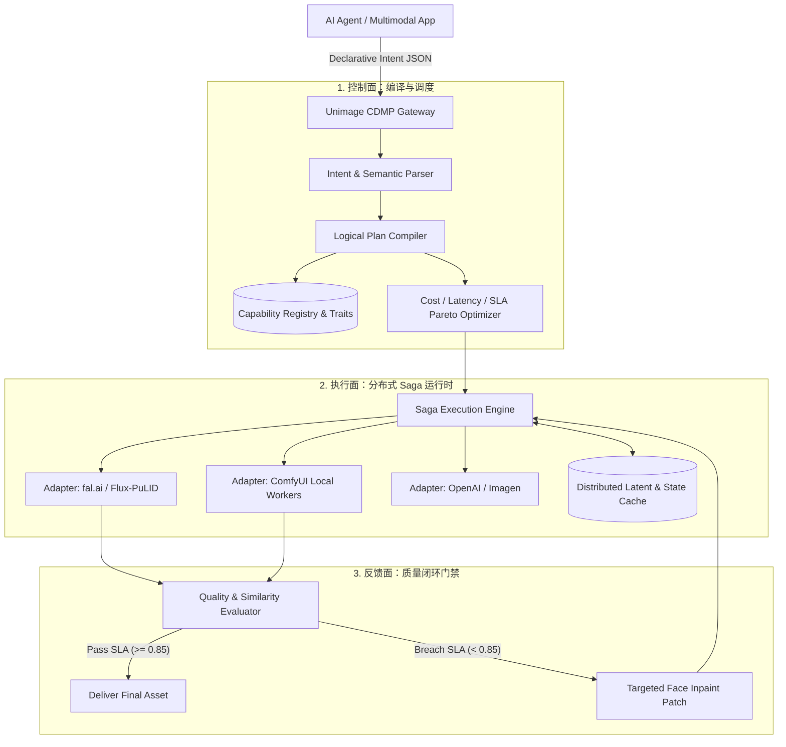

# Unimage: Capability-Based Generative Media Runtime Layer (CMRL)

[](https://www.python.org/)
[](LICENSE)
[]()

> **"SQL 编译器对于数据库的意义，等同于 Media Runtime 对于生成式模型的意义。"**  
> Unimage 是为 AI Agent 与下一代多模态应用打造的**声明式媒体运行时基础设施**。它打破了传统“图片版 One-API / API 聚合”的浅层参数映射死路，将生成任务抽象为**能力拓扑、状态编译与分布式 Saga 质量补偿**。

---

## 为什么生图/生视频领域不需要“另一个 One-API”？

| 维度 | 传统 API 聚合器 (OpenRouter / One-API) | Unimage (Media Runtime Layer) |
| :--- | :--- | :--- |
| **请求范式** | **Model-Centric**：调用方必须指定具体的模型（如 `dall-e-3` / `flux-schnell`）与私有参数 | **Intent-Centric**：声明语义意图、先验锚点（Anchors）与 SLA 约束，系统自动编译 |
| **工作流** | **单次前向调用**：只支持简单的 `Text -> Image` | **复合图执行（DAG）**：基模生成 + 局部 Mask + 特征注入 + 局部重绘 + 超分 |
| **一致性保障** | 无。多轮编辑角色面部漂移、风格割裂 | **原生长程一致性**：支持 PuLID/IP-Adapter/ConsisID 锚点注入与多轮会话潜向量缓存 |
| **失败语义** | HTTP 错误重试（重新全图生成，消耗 100% 算力且丢失已满意的背景） | **Saga 事务性局部补偿**：面部或文字不达标时，只触发局部打补丁（Targeted Inpainting Patch） |
| **状态维系** | 纯无状态（Stateless），每次重新传输 Base64/PNG 造成严重信息衰减 | **分布式 Latent & Context Mesh**：会话期内保留显存潜向量与 Attention Maps |

---

## 核心架构与工作流程



---

## 快速上手 (Quickstart)

### 1. 运行端到端声明式 Demo

Unimage 内置了高保真仿真环境，可无门槛体验“声明式意图 -> DAG 编译 -> 触发质量自愈修补”全流程：

```bash
# 执行示例管道
python examples/run_declarative_pipeline.py
```

### 2. Python SDK 核心调用代码

```python
import asyncio
from unimage import UnimageClient, DeclarativeMediaRequest, MediaIntent, MediaAnchor, MediaRequirements
from unimage.protocol import TaskType, AnchorType, FidelityLevel, Dimensions, QualityThresholds

async def run():
    client = UnimageClient()

    # 用户或 Agent 仅声明高层意图，无需关心具体调度哪个模型
    request = DeclarativeMediaRequest(
        intent=MediaIntent(
            task=TaskType.CHARACTER_CONSISTENT_EDIT,
            action="scene_transfer",
            prompt="将该角色置于霓虹雨夜街道，手持全息数据板，光影投射在面部"
        ),
        anchors=[
            MediaAnchor(
                type=AnchorType.IDENTITY,
                source_uri="s3://assets/character_master.png",
                target_region="face",
                fidelity=FidelityLevel.STRICT
            )
        ],
        requirements=MediaRequirements(
            dimensions=Dimensions(width=1280, height=720),
            max_cost_cents=8.0,
            max_latency_ms=7000,
            quality_thresholds=QualityThresholds(face_similarity=0.85)
        )
    )

    result = await client.dispatch(request)
    print(f"交付资产: {result.final_asset_uri}")
    print(f"SLA 检验: {result.sla_passed}, 自动修补轮次: {result.repaired_passes}")

asyncio.run(run())
```

### 3. 启动 API Gateway 服务

```bash
uvicorn unimage.api.server:app --host 0.0.0.0 --port 8000
```
访问 `http://localhost:8000/docs` 即可查看完整的 OpenAPI 交互式文档。

---

## 理论参考与学术前沿

* **Workflow Generation with LLMs**: *ComfyGPT: A Self-Optimizing Multi-Agent System for Comprehensive ComfyUI Workflow Generation* (arXiv:2503.17671)
* **Model Dynamic Routing**: *RouteLLM: Learning to Route LLMs with Preference Data* (LMSYS, ICLR 2025, arXiv:2406.18665)
* **Identity Consistency in Generation**:
  * *ConsisID: Frequency-Aware Identity-Preserving Video Generation* (CVPR 2025 Highlight, arXiv:2411.17440)
  * *StoryDiffusion: Consistent Self-Attention for Long-Range Image and Video Generation* (NeurIPS 2024 Spotlight, arXiv:2405.01434)
* **Transactional Reliability**: *Saga Pattern & Durable Execution in Distributed Systems*

---

## 路线图 (Roadmap)

- [x] **v0.1.0-alpha**：CDMP 核心协议、Capability Matrix、Logical/Physical 编译器、Saga 自愈补偿引擎、高保真仿真环境。
- [ ] **v0.2.0**：生产级 fal.ai、Replicate、ComfyUI WebSocket 双工驱动，Redis/S3 分布式 Latent 缓存。
- [ ] **v0.3.0**：集成真实 ArcFace / CLIP-aesthetic 实时推理门禁，支持多轮对话编辑（Multi-turn Session Context）。
- [ ] **v1.0.0**：企业级高可用分布式集群调度、动态 LoRA 热插拔、视频生成一致性工作流。

---

## 许可协议

Apache License 2.0. 详见 [LICENSE](LICENSE)。
