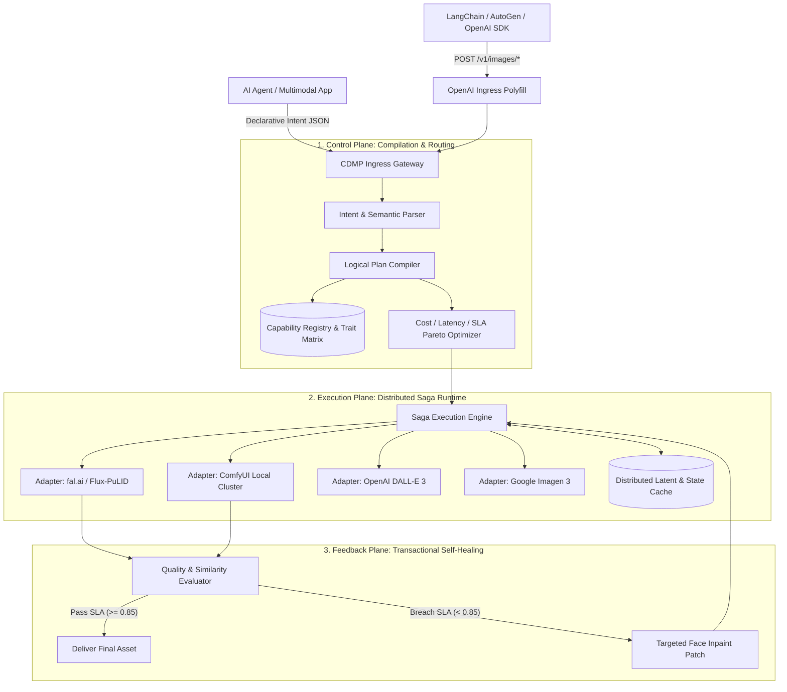

<div align="center">

# 🌌 Unimage

### The Capability-Based Generative Media Runtime Layer (CMRL) for AI Agents
**Declarative Intent Compilation • Saga Quality Compensation • Distributed Latent Mesh**

[](https://www.python.org/)
[](https://fastapi.tiangolo.com)
[](https://docs.pydantic.dev/)
[](LICENSE)
[]()

<p align="center">
  <a href="#-why-unimage">Why Unimage</a> •
  <a href="#-core-architecture">Architecture</a> •
  <a href="#-dual-direction-compatibility">Compatibility</a> •
  <a href="#-quickstart">Quickstart</a> •
  <a href="#-comparisons">Comparison</a> •
  <a href="#-whitepaper">Whitepaper</a>
</p>

---

</div>

> **"What the SQL Query Optimizer is to databases, the Media Runtime Layer is to generative diffusion models."**  
> 
> Unimage is an open-source, intent-driven **Media Execution Subsystem & Runtime**. It discards the flawed notion of "another simple image API aggregator" and elevates generative media dispatch to **declarative intent compilation, SLA-driven Pareto routing, and Saga transactional self-healing**.

---

## 💡 The 1D Token Illusion vs. The Multimodal Reality

In text LLMs, everything is a homogeneous 1D discrete sequence:
$$\text{input: } [\text{messages}] \longrightarrow \text{output: } [\text{tokens}]$$
Because semantics and parameters are symmetric across providers, projects like **OpenRouter** and **One-API** succeeded by providing shallow parameter mapping.

**Generative media operates under completely different physical laws:**

```
   Traditional API Aggregators (Dead End)                   Unimage Media Runtime (Next-Gen)
┌──────────────────────────────────────────────┐       ┌──────────────────────────────────────────────┐
│  Client selects: "model": "flux-schnell"     │       │  Client declares: Goal + Anchors + SLA       │
│  Client manually guesses CFG / Steps / Seed  │       │  - Action: "character_consistent_edit"      │
│  Client writes messy glue for inpainting     │  vs   │  - Anchors: [FaceID, Depth, Typography]      │
│  Failure = 100% full-image redraw ($$$)      │       │  - SLA: FaceSimilarity >= 0.85, Latency < 6s │
│  PNG round-trip destroys latent features     │       │  Compiler builds Dynamic DAG + Auto-Repairs  │
└──────────────────────────────────────────────┘       └──────────────────────────────────────────────┘
```

1. **Composite Pipelines (DAGs)**: Production media is never a single forward pass. It requires `Prompt Expansion -> Base Synthesis -> Face Detailer Mask -> IP-Adapter/PuLID Embedding -> Latent Denoise Patch -> Super-Resolution`.
2. **Latent State Destruction**: Passing decoded PNGs between microservices causes severe high-frequency loss. Unimage maintains a **Distributed Latent & Attention Mesh**.
3. **Stochastic Failures & Non-Deterministic Recovery**: Media models fail locally (bad hands, drifted face identity). Unimage applies **Saga-based compensating transactions**: if the facial quality gate fails, it executes a targeted inpainting patch without throwing away the rest of the canvas.

---

## 🏛️ Core Architecture



---

## 🔄 Dual-Direction Compatibility

Unimage acts as a **Universal Bridge** between legacy ecosystems and bleeding-edge heterogeneous GPU runtimes:

### 1. Ingress Polyfill (Upward Compatibility)
* Drop-in replacement for OpenAI Image API (`POST /v1/images/generations` and `POST /v1/images/edits`).
* Works out-of-the-box with **LangChain**, **LlamaIndex**, **AutoGen**, **NextChat**, **LobeChat**, and the official **OpenAI Python/Node SDK**.
* Existing calls are automatically upgraded into compiled DAGs with Saga compensation!

### 2. Egress Adapters (Downward Heterogeneous Runtimes)
* **fal.ai**: Async polling queue for ultra-fast serverless inference (Flux.1 Schnell/Dev).
* **OpenAI DALL-E 3**: Official HTTP client integration with automated error recovery.
* **Google Imagen 3**: REST prediction adapter for high-fidelity prompt adherence.
* **ComfyUI Workers**: REST prompt submission and history queue poller for self-hosted GPU nodes (PuLID, ControlNet, 4x-UltraSharp).

---

## ⚡ Quickstart

### Installation

```bash
git clone git@github.com:LoliLin/Unimage.git
cd Unimage
pip install -e .
```

### 1. Run the End-to-End Self-Healing Demo

Experience declarative intent compilation and dynamic Saga face-repair in your terminal:

```bash
python examples/run_declarative_pipeline.py
```

```text
┌─────────────────────────────────────────────────────────────────────────────┐
│ UNIMAGE: Capability-based Generative Media Runtime Layer (CMRL)             │
│ Demonstrating Declarative Intent, Dynamic DAG Compilation, and Saga Repair  │
└─────────────────────────────────────────────────────────────────────────────┘
1. Submitted Declarative Request:
  * Task: character_consistent_edit
  * Prompt: "A cyberpunk detective in rain-slicked Tokyo, holding a data pad"
  * Target SLA: Face Similarity >= 0.85 | Dimensions: 1280x720

2. Compiling Declarative Intent into Physical Execution DAG...

                           Saga Execution DAG Trace                            
┌────────────────────────────────────┬──────┬──────┬──────┬──────┬─────┬──────┐
│ Step ID                            │ Oper │ Prov │ Stat │ Dur  │ Cos │ Note │
├────────────────────────────────────┼──────┼──────┼──────┼──────┼─────┼──────┤
│ step_01_base_conditioned_synthesis │ base │ fal  │ COMP │ 4500 │ $0… │ Flux │
│ step_02_quality_eval_gate          │ eval │ unim │ COMP │ 0 ms │ $0… │ 0.79 │
│ step_03_saga_face_repair           │ saga │ comf │ COMP │ 1800 │ $0… │ 0.95 │
│ step_04_super_resolution           │ post │ comf │ COMP │ 1100 │ $0… │ 4x   │
└────────────────────────────────────┴──────┴──────┴──────┴──────┴─────┴──────┘
[SLA Gate Check: PASSED] Final Deliverable: https://cdn.unimage.dev/renders/art_4k.png
```

### 2. Python SDK Usage (For AI Agents)

```python
import asyncio
from unimage import UnimageClient, DeclarativeMediaRequest, MediaIntent, MediaAnchor, MediaRequirements
from unimage.protocol import TaskType, AnchorType, FidelityLevel, Dimensions, QualityThresholds

async def main():
    client = UnimageClient()

    # The Agent declares WHAT it needs, not WHICH model to run
    request = DeclarativeMediaRequest(
        intent=MediaIntent(
            task=TaskType.CHARACTER_CONSISTENT_EDIT,
            action="scene_transfer",
            prompt="Place this character in a neon-lit cyberpunk alleyway at night"
        ),
        anchors=[
            MediaAnchor(
                type=AnchorType.IDENTITY,
                source_uri="s3://assets/character_master_face.png",
                target_region="face",
                fidelity=FidelityLevel.STRICT
            )
        ],
        requirements=MediaRequirements(
            dimensions=Dimensions(width=1280, height=720),
            max_cost_cents=8.0,
            quality_thresholds=QualityThresholds(face_similarity=0.85)
        )
    )

    result = await client.dispatch(request)
    print(f"Asset Delivered: {result.final_asset_uri}")
    print(f"SLA Passed: {result.sla_passed} (Saga Auto-Repair Passes: {result.repaired_passes})")

if __name__ == "__main__":
    asyncio.run(main())
```

### 3. Launching the API Gateway (OpenAI-Compatible)

```bash
uvicorn unimage.api.server:app --host 0.0.0.0 --port 8000
```

Now talk to it using standard cURL or the official OpenAI Python SDK:

```bash
curl http://localhost:8000/v1/images/generations \
  -H "Content-Type: application/json" \
  -d '{
    "prompt": "Cyberpunk street with holographic banners",
    "size": "1024x1024",
    "quality": "standard"
  }'
```

---

## 📊 Ecosystem Comparison

| Dimension | OpenRouter / One-API | fal.ai / Replicate | ComfyUI Ecosystem | **Unimage (This Project)** |
| :--- | :--- | :--- | :--- | :--- |
| **Abstraction Level** | Model-Centric (Raw parameters) | Serverless Model Endpoints | Imperative Node Wiring | **Intent-Centric (Goal + SLA)** |
| **Workflow Synthesis** | None (Single forward pass) | Static Chained Pipelines | Manual fragile wiring | **Dynamic DAG Compiler** |
| **Consistency Guarantees** | None | Raw image upload | PuLID / IP-Adapter nodes | **Native Identity Anchors** |
| **Failure Handling** | Full redraw retry (100% cost) | Queue task retry | Crashes on error | **Saga Transactional Inpaint Repair** |
| **State Management** | Stateless (Pixel round-trip) | Ephemeral URLs | Local host memory only | **Distributed Latent & State Mesh** |
| **Agent Readiness** | Low | Medium | Very Low (Too complex) | **Optimal (Designed for Agents)** |

---

## 📚 Academic Grounding & Literature

Unimage is built upon recent breakthroughs across multimodal reasoning, dynamic routing, and workflow synthesis:

* **Workflow Generation with LLMs**: *ComfyGPT: A Self-Optimizing Multi-Agent System for Comprehensive ComfyUI Workflow Generation* ([arXiv:2503.17671](https://arxiv.org/abs/2503.17671))
* **Model Dynamic Routing**: *RouteLLM: Learning to Route LLMs with Preference Data* ([arXiv:2406.18665](https://arxiv.org/abs/2406.18665), ICLR 2025)
* **Identity-Preserving Synthesis**:
  * *ConsisID: Frequency-Aware Identity-Preserving Video Generation* ([arXiv:2411.17440](https://arxiv.org/abs/2411.17440), CVPR 2025 Highlight)
  * *StoryDiffusion: Consistent Self-Attention for Long-Range Image and Video Generation* ([arXiv:2405.01434](https://arxiv.org/abs/2405.01434), NeurIPS 2024 Spotlight)
* **Distributed Reliability**: *Saga Pattern & Durable Execution in Distributed Systems*

For complete mathematical definitions and design rationales, please consult the [Architecture Whitepaper](docs/ARCHITECTURE_SPEC.md).

---

## 🗺️ Roadmap

- [x] **v0.1.0-alpha**: CDMP Protocol Specification, Capability Trait Matrix, Logical/Physical Compilers, Saga Compensator, High-Fidelity Simulation Engine.
- [x] **v0.1.5**: Dual-Direction Compatibility (OpenAI Ingress Polyfill + Egress Adapters for OpenAI, Gemini, fal.ai, ComfyUI).
- [ ] **v0.2.0**: Redis/S3 remote latent paging mesh, streaming WebSocket progress events.
- [ ] **v0.3.0**: Native ArcFace and CLIP-aesthetic embedding gate workers.
- [ ] **v1.0.0**: Distributed GPU cluster auto-scaler and text-to-video consistency compiler.

---

## 👤 Author

* **Lolilin** - [GitHub](https://github.com/LoliLin) • [Email](mailto:teawhat2000@gmail.com)

---

## 📄 License

This project is licensed under the Apache License 2.0 - see the [LICENSE](LICENSE) file for details.
